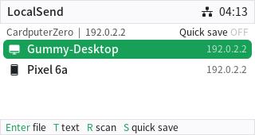
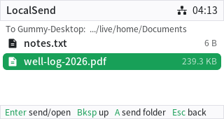
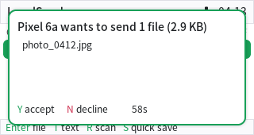
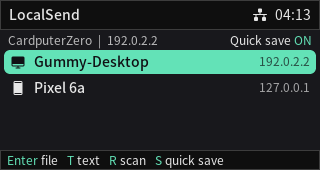

# LocalSend for CardputerZero (GUI app)

A native LVGL launcher app for the M5Stack CardputerZero. It is built on M5Stack's
[CardputerZero Template](https://github.com/CardputerZero/template), so it looks and
behaves like the other launcher apps. It talks to the `lsend` daemon (`../lsend.py`),
which handles the LocalSend v2.1 protocol.

<p>
  
  
  
  
</p>

## Install on the Zero

1. Get the `.deb`: open the repo's **Actions** tab, pick the latest
   **Build CardputerZero app (.deb)** run, and download the `LocalSend-CardputerZero-deb` artifact
   (a zip containing the `.deb`).
2. Copy it to the Zero and install it:
   ```sh
   scp LocalSend_*_arm64.deb <user>@<zero-ip>:~
   ssh <user>@<zero-ip> 'sudo apt install -y ./LocalSend_*_arm64.deb'
   ```
3. Open **LocalSend** from the launcher.

The package installs:

| Path | What |
| --- | --- |
| `/usr/bin/lsend_app` | GUI app |
| `/usr/bin/lsend` | protocol daemon / CLI (Python 3, stdlib only) |
| `/usr/share/APPLaunch/applications/lsend_app.desktop` | launcher entry |
| `/usr/share/APPLaunch/share/images/lsend*.png` | launcher icon |
| `/etc/lsend-app.conf` | theme (`dark_mode=yes/no`) |

The app starts `lsend daemon` in the background on first launch. The daemon keeps running after
you close the app, so the Zero stays visible to your phone. While the app is closed, incoming
transfers are declined unless **Quick save** is on.

## Keys

| Screen | Keys |
| --- | --- |
| Devices | Up/Down (or `;` `.`) select, **Enter** pick a file, **T** send text, **R** rescan, **S** quick save on/off, hold **Esc** to exit |
| Files | Up/Down select, **Enter** send file / open folder, **Bksp** or `,` parent folder, **A** send this whole folder, **H** show hidden, **Esc** back |
| Text | type, **Enter** send, **Esc** cancel |
| Incoming | **Y** accept, **N** decline |

## Build it yourself

GitHub Actions builds it on every push (`.github/workflows/build-app.yml`). To build locally on
Debian/Ubuntu (CMake 3.31 or newer is required):

```sh
sudo apt install -y crossbuild-essential-arm64 ninja-build dpkg-dev
cd app
cmake --workflow --preset cp0-cross-package   # -> dist/LocalSend_<ver>_rev1_arm64.deb
```

The first configure downloads M5Stack's CardputerZero BSP sysroot.

## Code map

| File | Role |
| --- | --- |
| `src/view/screens/lsend_screen.*` | All screens, pop-ups and key handling |
| `src/viewmodel/lsend_client.*` | Unix-socket client for `lsend daemon` (spawns it if needed) |
| `src/viewmodel/json_lite.*` | Small JSON parser for the control protocol |
| `src/view/widgets/hint_bar.*` | Bottom key-hint bar |
| `src/platform/linux_input.cpp` | evdev keyboard, extended to the full keyboard with Shift |
| `src/app/app.cpp` | Startup, theme, display, key routing |

The control protocol (one JSON object per line) is documented at the top of the `daemon` section
in `../lsend.py` (search for `GUI -> daemon`).

## Before publishing to the M5 app store

- Set your email in `APP_MAINTAINER` (`cmake/cm0-package.cmake`).
- Check that the share code `LSND` in `app-builder.json` is still free.
